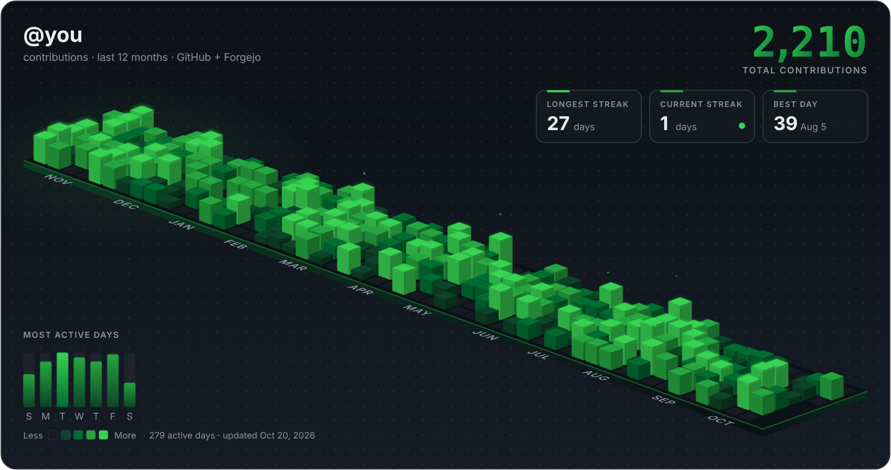
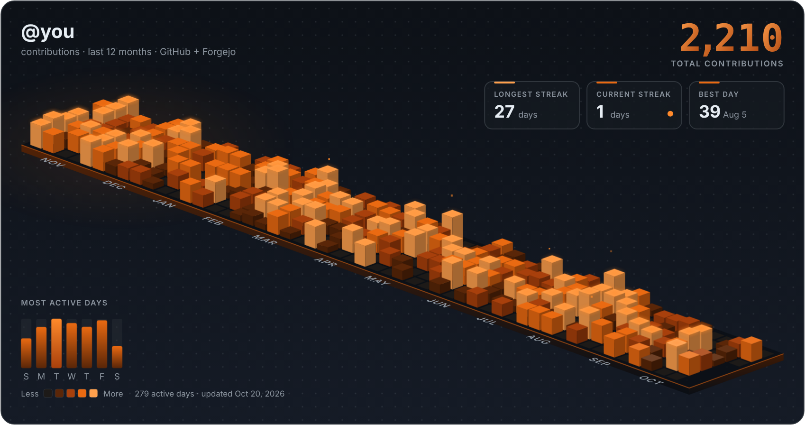
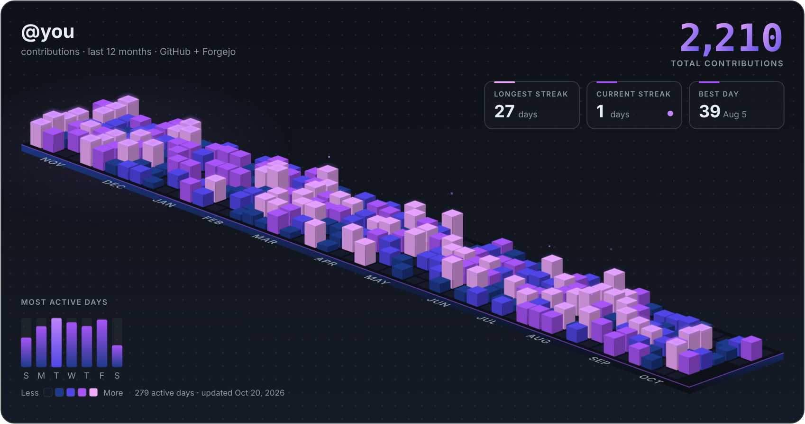

# Contribution Skyline

An animated, isometric 3D contribution graph for your profile README. It works on **GitHub**, **Forgejo/Codeberg**, or **both merged into one graph**.



The SVG plays an animation when it loads:

- **Towers drop in** along a diagonal wave, with a little overshoot bounce
- **Odometer counter**: the total rolls into place digit by digit, like a slot machine
- **Light sweep**: a shimmer runs across the skyline every few seconds
- **Glowing peaks**: your busiest days pulse, and sparks float up from the tallest towers
- **Live streak indicator**: a pulsing ring on the current-streak card
- The weekday bars grow in, and month labels sit flat on the ground plane
- The animation turns off when the viewer has `prefers-reduced-motion` set

Everything is pure SVG and CSS, with no JavaScript, so it works inside `` tags on GitHub and Forgejo.

## Themes

| `github` | `forgejo` | `aurora` |
| --- | --- | --- |
|  |  |  |

Every theme has a dark and a light variant (`output/skyline-dark.svg`, `output/skyline-light.svg`).

## Data sources

Pass any number of sources with `--source`, or put them in the `SOURCES` env var (separated by spaces or commas). Their counts are added up per day.

| Source | Spec | Token |
| --- | --- | --- |
| GitHub | `github:USER` | `GH_README_TOKEN` (or `GITHUB_TOKEN`), required |
| Forgejo / Gitea | `forgejo:https://host/USER` | `FORGEJO_TOKEN`, optional. Only needed for private instances. |
| Codeberg shorthand | `codeberg:USER` | same as Forgejo |

Forgejo data comes from the public `/api/v1/users/USER/heatmap` endpoint. The user needs **public activity** enabled for it to work (Settings → Profile, don't tick "Hide activity from profile page"). Activity is grouped into days using `--tz` / `TZ_NAME` (default `UTC`).

Color levels follow GitHub's own buckets when GitHub is the only source. Otherwise they're computed from quartiles of your active days. Tower height uses a log scale on the raw count, so a huge day doesn't turn into a spike.

## Local preview

```bash
python3 generate.py --mock --out tmp                      # fake data
python3 generate.py --mock --theme aurora --out tmp
GH_README_TOKEN=... python3 generate.py --source github:you --out tmp
python3 generate.py --source codeberg:you --theme forgejo --tz Europe/Warsaw --out tmp
python3 generate.py --source github:you --source codeberg:you --name "Your Name" --out tmp
```

Other flags: `--name` sets the card title, and `--no-card` gives a transparent background with no frame. It needs only Python 3.9+ and has no dependencies.

---

## Setup on GitHub

1. Push this repo to GitHub as a **public** repo, for example `you/contrib-skyline`.
2. Create a classic personal access token (Settings → Developer settings → Tokens). Add `read:user` if you want private contributions counted. Save it as the repo secret **`GH_README_TOKEN`**.
3. Optionally, add repo **variables** (Settings → Secrets and variables → Actions → Variables):
   - `SOURCES`: for example `github:you codeberg:you`. The default is `github:<repo owner>`.
   - `THEME`: `github` | `forgejo` | `aurora`
   - `TZ_NAME`, `DISPLAY_NAME`
4. Actions tab → *Update contribution skyline* → **Run workflow**. After that it runs every day.
5. In your profile repo (`you/you`), add this to `README.md`:

```html
<picture>
  <source media="(prefers-color-scheme: dark)"
          srcset="https://raw.githubusercontent.com/you/contrib-skyline/main/output/skyline-dark.svg" />
  
</picture>
```

## Setup on Forgejo / Codeberg

1. Push this repo to your Forgejo instance as a **public** repo, for example `codeberg.org/you/contrib-skyline`.
2. Enable Actions for the repo (Settings → Units → Actions). On Codeberg, Actions has to be requested or enabled, and the hosted runner labels are different. Change `runs-on:` in `.forgejo/workflows/update-skyline.yml` to match your runner.
3. Add repo **variables** under Settings → Actions → Variables:
   - `SOURCES`: for example `codeberg:you` or `forgejo:https://git.example.com/you github:you`
   - `THEME` (default `forgejo`), `TZ_NAME`, `DISPLAY_NAME`
4. Add secrets if you need them: `GH_README_TOKEN` if you include GitHub, `FORGEJO_TOKEN` for private instances, and `PUSH_TOKEN` (an access token with repo write access) if the automatic token can't push.
5. Run the workflow once by hand. After that it runs every day.
6. Forgejo profile READMEs live in a repo named **`.profile`** (`you/.profile`, with a `README.md` at the root):

```markdown

```

Forgejo's markdown sanitizer may strip `<picture>`, so a plain image is the safest choice. Pick the variant that suits your instance's default theme.

> Can't (or don't want to) run Actions on your Forgejo instance? Let the GitHub workflow fetch both sources (`SOURCES="github:you codeberg:you"`) and embed the GitHub raw URL in your Forgejo `.profile` README too.

## Files

- `generate.py`: fetches the data and renders both SVGs
- `.github/workflows/update-skyline.yml`: daily refresh on GitHub Actions
- `.forgejo/workflows/update-skyline.yml`: daily refresh on Forgejo Actions
- `output/`: the generated SVGs, committed by the workflows

Inspired by [colincode0/github-readme](https://github.com/colincode0/github-readme).
